<h3><code>Code-with-areeb@github ~ $ ./contributions.sh</code></h3>

  

<h3><code>Code-with-areeb@github ~ $ whoami</code></h3>
<table>
  <tr>
    <td valign="top"></td>
    <td valign="top"></td>
  </tr>
</table>

 

<h3><code>Code-with-areeb@github ~ $ tech --stack</code></h3>

  
  
  
  

<!--
Regenerate locally (Python 3.11+ and Node.js for the preview server):

  python -m venv .venv
  .venv\Scripts\activate          # Windows
  # source .venv/bin/activate       # macOS / Linux
  pip install -r scripts/requirements.txt

  # 1. Edit scripts/profile.py to update your identity and card copy.
  # 2. Add a portrait as source-photo.jpg, then prepare and render it:
  python scripts/prep_photo.py
  python scripts/make_ascii_svg.py
  # Or generate a placeholder until you have a portrait:
  python scripts/make_placeholder_photo.py
  python scripts/make_ascii_svg.py

  python scripts/make_info_card.py
  python scripts/fetch_contributions.py
  python scripts/render_heatmap_svg.py

Preview the generated profile with `node serve.js`, then open
http://127.0.0.1:8765. Push this repository as Code-with-areeb/Code-with-areeb
to render it on your GitHub profile. GitHub Actions refreshes the heatmap daily.

Keep widths aligned: heatmap 860 = portrait 230 + card 630.
-->